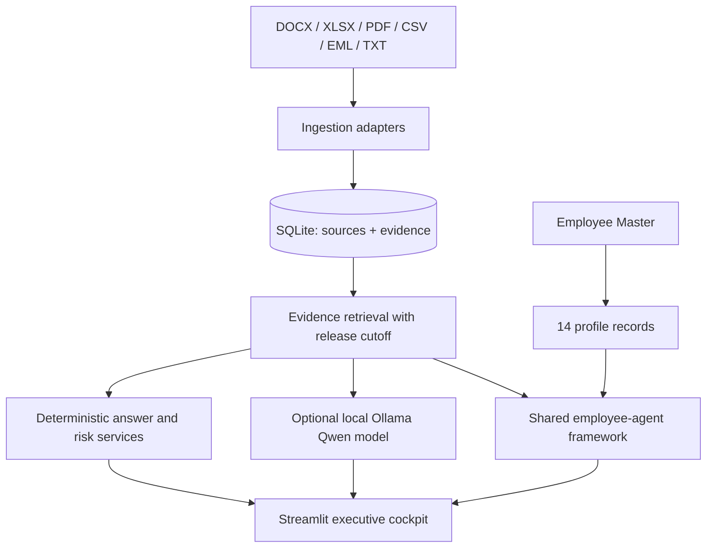

# Architecture — Veloxa CXO Cockpit

## Product objective

Veloxa Intelligence is a local-first, evidence-grounded executive cockpit for the fictional Veloxa Technologies hackathon dataset. It ingests the four staged release folders, preserves source provenance and release availability, provides CEO question answering, a ranked risk view, 14 employee agents, department/project views, and a historical evidence explorer.

## Architecture



### Components

- `veloxa/ingestion.py`: extracts source content, creates SHA-256 source IDs, and stores evidence units with source path, locator and release timestamp. `veloxa/normalize.py` builds queryable structured tables from employee, finance GL, Jira, incidents, pulse, hiring, leave, Git and on-call exports.
- `veloxa/people.py`: reads the Employee Master and selects exactly the four departments in the challenge scope: Engineering, Finance, People & Ops, and Marketing. The resulting 14 records are the 14 agents. Sales, Support and Leadership remain in the wider master but are not agent profiles.
- `veloxa/answer_engine.py`: deterministic, testable answer paths for high-value facts and sensitive/refusal cases. Unknown questions use evidence retrieval and return uncertainty rather than fabricated facts.
- `veloxa/agents.py`: one shared framework instantiated for each of the 14 people. Agents retrieve from the same evidence store; no agent is an independent source of truth.
- `veloxa/ollama_client.py`: optional local LLM adapter. If Ollama is unavailable, a deterministic evidence-summary fallback remains available. The model is a language layer, not the authority for facts.
- `app.py`: Streamlit UI with overview, chat, risks, agents, departments, Atlas, historical replay, evidence explorer and assumptions/conflicts.

## Data model

SQLite tables:

- `sources(source_id, file_name, relative_path, release_at, file_type, sha256, extracted_text)`
- `evidence(evidence_id, source_id, locator, text, release_at)`
- Normalized structured tables: `employees`, `financial_transactions`, `jira_issues`, `jira_versions`, `incidents`, `pulse_scores`, `hiring_requisitions`, `leave_records`, `git_commits`, `oncall_assignments`, `agent_profiles`.
- Individual payroll rows are not normalized into a CEO-facing table; row-level payroll evidence is suppressed from the search/index surface in accordance with T2.
- `assumptions(assumption_id, created_at, subject, assumption, source_basis, confidence, what_changes_mind, status)`
- `conflicts(conflict_id, topic, claim_a, claim_b, working_conclusion, rationale, confidence, source_refs)`

The raw release pack is retained under `data/raw/Veloxa_Hackathon_Release_Packs/`. The database is rebuildable and should not be committed as the only copy of source data.

## Evidence and provenance

Each evidence unit has a stable evidence ID, source file name, relative path, locator (document, section, PDF page or workbook sheet), and release timestamp. The UI displays source file names and locators. Spreadsheet evidence is split into individual sheet rows with Excel row numbers; PDFs are split by page; other documents are split into sections where possible.

## Release-aware knowledge

| Release | Available from (IST) |
|---|---|
| Day 1 | 2026-11-16 10:00 |
| Day 2 | 2026-11-17 10:00 |
| Day 3 | 2026-11-18 10:00 |
| Day 4 | 2026-11-19 10:00 |

The retrieval layer filters `evidence.release_at <= requested_cutoff`. A fact's event date does not make a later export available earlier. This implements the hackathon's release-date knowledge boundary. A full bitemporal extension would add `event_date`, `recorded_at`, `valid_from` and `valid_to` to normalized fact records.

## Confidence policy

- High: direct, authoritative, internally consistent evidence for the specific claim.
- Medium: a direct source exists but a material scope, date or corroboration gap remains.
- Low: ambiguous identity, transcript-only claim or unresolved contradiction.
- Unknown/disputed: evidence is absent or materially inconsistent; answer says so explicitly.

Confidence is assigned by rule and source assessment, not generated as a probability by the LLM.

## Agent design

Fourteen agents are generated from the employee master, not manually invented identities. The agent profile includes employee ID, name, email, department, title, manager ID, joining date, location, employment status and exit date. A small, explicitly fictional personal-life/persona detail is attached to each agent and documented in `ASSUMPTIONS.md`. It is never treated as evidence about actual private thoughts. Agents use shared retrieval and the same refusal policy.

## Privacy and safety

- Do not expose individual payroll/salary information in the CEO interface, consistent with T2.
- Do not provide private Slack messages; no Slack export exists.
- Do not rank named employees by likelihood of quitting from leave, pulse or workload data.
- Do not expose small-team pulse comments; the supplied export explicitly suppresses comments for teams below six.
- Do not infer productivity from Git commit counts or story points.

## One-command run

```bash
python -m pip install -r requirements.txt && python -m streamlit run app.py
```

The app initializes SQLite and ingests all supported source files on first run. Ollama is optional. To use local generation, run Ollama and set `VELOXA_MODEL` (default `qwen2.5:14b-instruct`) and optionally `OLLAMA_BASE_URL`.

## Tests

```bash
pytest -q
```

Tests exercise the actual supplied release pack, key metrics, agent count, refusal/uncertainty behavior and release cutoffs.


## v2 additions (accuracy rebuild)
- `veloxa/data.py`: single parsing path for every raw file (row-numbered tables, board PDF parser, emails).
- `veloxa/facts.py`: all figures computed from raw data with row-level source refs; two documented identity inferences only.
- `veloxa/intents.py`: normalisation (mishearing aliases), word-boundary entity/date parsing.
- `veloxa/answer_engine.py`: intent router + release-gated handlers; optional closed-menu LLM classifier.
- `veloxa/timeline.py`: two-layer point-in-time reconstruction (company records vs cockpit releases).
- `veloxa/guard.py` + `veloxa/llm.py`: the only path by which a model touches an answer; verified text is the fallback.
- `veloxa/permissions.py`: allow-list privacy layer (salary columns never loaded/stored).
- `veloxa/risks.py`: transparent impact x likelihood x evidence scoring, release-aware.
- `eval/` + `scripts/evaluate_accuracy.py`: independent oracle, golden/held-out/fresh sets, groundedness & leakage audit.
The paragraphs above describing "deterministic evidence-summary fallback" are superseded by ACCURACY.md.
